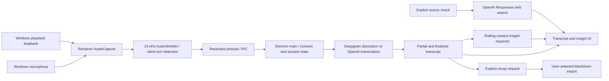

# Architecture and product path

## Decisions from the design conversation

- Windows desktop first; future iPhone support.
- Windows microphone for in-room speech/external speakerphones; Windows playback loopback for Zoom/Teams; optional both-source mixing.
- Cloud processing permitted; OpenAI first, with provider code separated from UI and audio code.
- Individual use first, preserving a route to a commercial product.
- Session-only meeting memory, no saved raw audio, explicit exports.
- Personal API key for the MVP; roughly 1–2 second partial-transcript and 2–5 second initial-insight targets, subject to measurement.

## Components

`src/shared.ts`, `src/core.ts`, and `src/turns.ts` hold reusable contracts and logic. `src/audio.ts` is the browser/desktop capture adapter. `electron/transcription.ts` owns Deepgram/OpenAI transcription transports. `electron/provider.ts` contains structured insight requests, research parsing, and recap generation. `src/speakers.ts` resolves speaker identities/names and insight associations. `electron/credentials.ts` owns protected credential persistence and migration. `electron/main.ts` owns credential IPC, permission gating, network access, and filesystem export. React owns only the volatile presentation state.

The provider currently runs inside Electron's main process for a personal bring-your-own-key workflow. A shipped commercial service must move shared provider credentials and entitlement enforcement to an authenticated backend. Never distribute one company API key inside the desktop or iPhone app.

## Audio lifecycle

Idle denies microphone/display permissions. Live start requires an explicit consent boolean in the main process and a configured credential. Main opens and configures transcription before authorizing capture. Renderer then opens the selected devices and starts its worklet. Only audio samples leave the renderer. System video tracks are stopped immediately.

Deepgram mode streams continuous audio, including silence, so word timestamps use the captured-audio timeline. The provider handles endpointing and assigns per-word speaker IDs. OpenAI-only client speech segmentation sends buffered preroll once speech crosses an RMS threshold, commits after a pause or five-second turn, and avoids continuously appending long silence. OpenAI-only mode has no acoustic model-based VAD; quiet speech may need threshold tuning. Audio data is memory-only.

Pause/end/device loss/provider disconnect close tracks, the AudioContext, the WebSocket, and pending live-insight requests. Session generations suppress stale live events. There is no automatic capture restart. Resume creates a new transcription session and provides prior finalized text to the insight pipeline, not old audio. Deepgram turns use first-word audio timestamps; OpenAI-only segment timestamps remain receipt-based estimates. Resumed transcription assigns fresh speaker identities; users can explicitly match them to prior people. See [speaker behavior and limitations](SPEAKERS.md). Pause intentionally drops unfinished speech.

The app uses Windows default-output loopback. It does not isolate a single conferencing process. Changing output devices mid-session may require a pause and restart. Both-source mixing can double audio picked up from speakers; headphones are recommended.

## Speaker-focused review

The default workspace selects the latest finalized voice. Choosing a person holds a snapshot of their insights; new results wait for explicit loading. Two-card pages, category/search/quiet filters, and transcript context links support review at a stable pace. Editable names and the self marker are session-only; explicit matches group split or resumed labels by immutable identity. Names are included in insight/recap requests and Markdown exports. See [speaker design](SPEAKERS.md).

## Insight and evidence policy

The assistant receives preparation, recent finalized passages with IDs, and prior titles. It returns structured category cards; application validation rejects unknown categories and nonexistent trigger IDs. Transcript/prep are treated as untrusted content, never as operational instructions. AI output is rendered as plain React text, not raw HTML.

Categories: answer, solution, background, insight, question (suggested follow-up), terminology, risk, evidence. Answers and solutions require an asked-question excerpt, a validated trigger ID, and supporting details. They are high priority and sort ahead of other insights. Icons and text reinforce category color. Evidence cards initially identify claims needing checking. An explicit research request invokes web search. Only valid HTTPS URL annotations from the provider become citation links. Source retrieval is not an application-level verdict that a claim is correct. A failure is shown, not disguised as a sourced response.

The provider prioritizes direct responses to asked questions, with a concise body and supporting detail. Prior response context reduces repetition; response deduplication includes question and trigger identity so a reused title does not suppress an answer to a different question. Each request uses unique card IDs across resumed sessions. The UI preserves held-result snapshots and exposes pending answers and responses from other speakers.

Insight generation is serialized with a configurable minimum interval; finalized turns arriving during a request schedule another pass. WebSocket outgoing-buffer bounds stop a session rather than creating unbounded latency. Current product targets need real workload instrumentation before public latency promises.

## Retention

- Raw audio: not written by application code.
- Transcript, insight cards, prep, recap: memory until close/reset; no automatic meeting history.
- Settings: ordinary app-data JSON, no meeting prep/transcript.
- API keys (OpenAI and Deepgram): OS-protected encrypted storage by default outside source checkouts, main-process memory while in use, explicit session-only option, and restart recovery. See [credential design and security limits](CREDENTIALS.md).
- Export: explicit save dialog and a Markdown file at the selected location.
- Cloud: provider policies apply. `store: false` is set for Responses calls; no claim of zero retention or compliance certification.

## iPhone path

Reuse TypeScript contracts, categorization rules, tests, and a server-side provider boundary. Build an iOS capture adapter and mobile interface using React Native/Expo with native audio support or a Swift client. Electron's Windows capture adapter cannot run on iOS.

Start iPhone support with foreground, consented in-room microphone capture. Do not promise arbitrary Zoom/Teams/Phone app audio interception or unlimited background listening. Cross-app audio and phone-call capture depend on iOS APIs, permissions, distribution policy, and the specific meeting/telephony integration. Research and prototype the permitted route when mobile work begins; use an explicit provider integration or user-supplied recording where appropriate.

## Commercial release milestones

1. **Personal audio validation:** permission denial, all three sources, external speakerphone/headset routing, disconnects, silence, long meetings, rate limits, cost, and actual latency measurements. Validate useful prompts against realistic consented technical meetings.
2. **Product reliability:** stronger VAD, better transcript alignment, further diarization accuracy validation and corrections, accessibility audit, configurable card density, robust network recovery that requires capture reauthorization, and crash/error reporting with explicit redaction.
3. **Service boundary:** authentication, rate/cost budgets, short-lived transcription credentials, server-held provider keys, abuse protection, tenant isolation, and billing. Add a provider interface when a second provider is implemented rather than advertising an unimplemented switch.
4. **Distribution and privacy:** signed/notarized builds as appropriate, signed update delivery, provider/subprocessor disclosures, consent UX review, threat modeling, data-deletion controls, and release dependency/license review. Determine applicable requirements for the intended markets and data classes before making compliance claims.
5. **Expanded artifacts:** transcript-grounded generated diagrams, imported prep documents, richer editable notes, and reviewed integrations. The current architecture diagram is intentionally a fixed labeled demo reference.
6. **Mobile prototype and pilot:** validate iPhone capture constraints, battery/thermal/network behavior, interruption handling, and App Store distribution requirements before promising feature parity.

## Primary implementation references

- [Electron desktop capture](https://www.electronjs.org/docs/latest/api/desktop-capturer)
- [Electron security](https://www.electronjs.org/docs/latest/tutorial/security)
- [Deepgram streaming diarization](https://developers.deepgram.com/docs/diarization)
- [Deepgram live audio protocol](https://developers.deepgram.com/reference/speech-to-text/listen-streaming)
- [OpenAI realtime transcription](https://developers.openai.com/api/docs/guides/realtime-transcription)
- [OpenAI structured outputs](https://developers.openai.com/api/docs/guides/structured-outputs)
- [OpenAI data controls](https://platform.openai.com/docs/guides/your-data)
- [Windows loopback recording](https://learn.microsoft.com/en-us/windows/win32/coreaudio/loopback-recording)

These references informed the Windows MVP. Future iOS capabilities must be verified against the platform documentation at implementation time.
